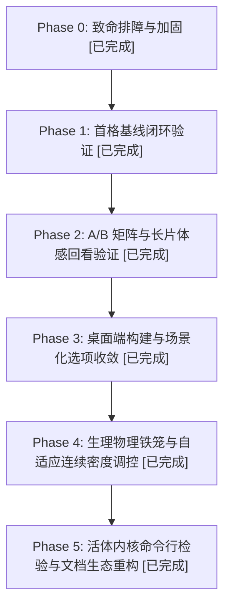

# PLAN

行动路线看板。**每次会话必读全文（<60 行）。**  
细节归档见 `REPORT.md`，宪章规则见 `AGENT.md`，当前状态见 `STATE.md`。

## 1. 当前执行路线图

## 2. 阶段明细与验收门禁

### Phase 4: 生理物理铁笼与连续密度自适应调控 [100% 完成]
- **VAD 连续静音密度调控**：`limit(ratio)` 4s~16s 动态伸缩，统一 `_take()` 落地；
- **UI 连续阅读速率消散**：`DismissDelay(N)` 1.5s~6.0s 依字数平滑下潜，短词早退不霸屏；
- **长周期内存暗漏防御**：抽屉 QWidget 彻底销毁，后端持续 30s 静音自动清理 ASR 缓存并触发 GC。

### Phase 5: 活体内核命令行检验与文档生态重构 [100% 完成]
- **内存硬约束 SSOT**：`--cache-ram 512 --ctx-checkpoints 1 --no-cache-idle-slots` 全局注入，杜绝内存膨胀；
- **活体内核命令行校验**：`scripts/verify_live_llama_args.py` 自动查验 `Win32_Process` 真实内核命令行与引擎遥测日志，杜绝假阳性；
- **文档物理隔离与行数门禁**：`AGENT.md` 瘦身至 <50 行纯行动契约，历史故事沉淀进 `REPORT.md`，根除上下文漂移。

## 3. 实验纪律

- 每次实验前先立判据，实验超时（30 分钟）即停。
- 严禁修改断言掩盖分支错误；历史背景查阅统一执行 `python scripts/rag.py query "..."`。