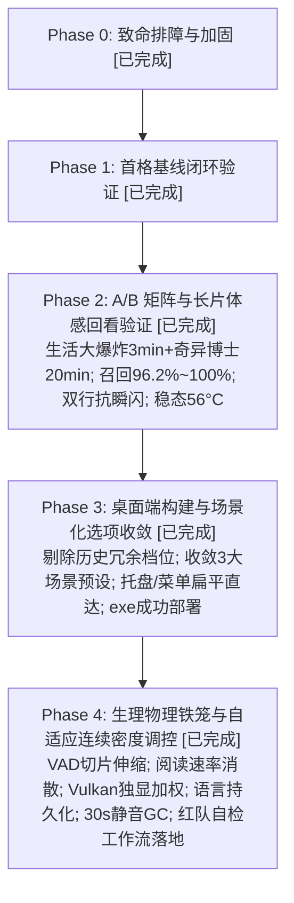

# PLAN

行动路线看板。**每次会话必读全文（<60 行）。**
细节归档见 `REPORT.md`，宪章规则见 `AGENT.md`，当前状态见 `STATE.md`。

## 1. 当前执行路线图

## 2. 阶段明细与验收门禁

### Phase 3: 桌面端构建与场景化选项收敛 [100% 完成]
- **去除冗余参数**：砍掉 0/80/320/560/750/2000ms 等历史调参产物；
- **三大场景预设一键直达**：🎬电影追剧（1000ms+双行+整句）、⚡演讲对话（500ms+双行）、🎙️极速同传（160ms+单行）；
- **构建与测试闭环**：PyInstaller 构建完成并部署至 `D:\TranslationDesktop`。

### Phase 4: 生理物理铁笼与连续密度自适应调控 [100% 完成]
- **SSOT 唯一配置源**：`server/serve_config.py` 统合 ASR (`-c 2048 -np 4`) / MT (`-c 2048 -np 3`) 与全部启动脚本；
- **VAD 连续静音密度调控**：`limit(ratio)` 4s~16s 动态伸缩，移除 8000ms 静态夹层，统一 `_take()` 落地；
- **UI 连续阅读速率消散**：`DismissDelay(N)` 1.5s~6.0s 依字数平滑下潜，短词早退不霸屏，长句从容阅读；
- **Vulkan 独显精准绑定**：修复 64 位 Windows ctypes 指针截断，加权评分（独显+150 vs 核显-50）锁定 RTX 显卡；
- **长周期内存暗漏防御**：抽屉 QWidget 彻底销毁，后端持续 30s 静音自动清理 ASR 缓存并触发 GC；
- **红队自检工作流闭环**：`.agents/workflows/redteam-audit.md` 固化为发布前门禁；打包输出 `TranslationDesktop-Release.zip`。

## 3. 实验纪律

- 每次实验前先立判据，实验超时（30 分钟）即停。
- 严禁修改断言掩盖分支错误；历史背景查阅统一执行 `python scripts/rag.py query "..."`。